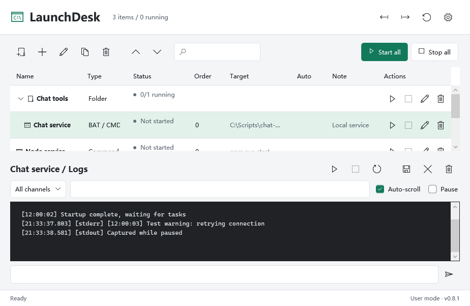

# LaunchDesk

[Simplified Chinese](README.md) | [English](README.en.md)

A Windows desktop manager for scripts, commands and applications, with real-time logs. Current version: **v0.8.0** (unsigned prerelease, early development).

**Release status:** This is an unsigned prerelease for manual download and installation only. Missing production signing configuration still blocks the trusted update pipeline. Test certificates never enter production trust. See [Trust and engineering verification](docs/trust-and-engineering.md).



[Current screenshots](docs/screenshots.md) (v0.8.0; isolated fixture data, not first-install configuration).

## Features

### New and Fixed in v0.8.0

- Health monitoring, CLI and crash recovery; per-item UAC and separate LocalService hosting.
- Accessible names/labels, keyboard focus, F2 inline editing and folder arrow keys; bilingual installer.
- Separate service/desktop data; desktop upgrades do not silently replace service runtime.
  Real UAC/SCM, screen reader and physical Win10 acceptance remain pending.
  See [service/accessibility details](docs/service-accessibility-installer.md).
- Fixed service path validation, local identity handle disposal and stale packaging isolation; see [release review](docs/release-v0.8.0.md).

### Fixed in v0.7.1

- Shared 4 MiB serialized byte limit for configuration reads, saves, exports and backups; rejected writes preserve existing files.
- Failed migration finalization restores the selected empty directory and reports the retained staging path.
- Unique save temporary files, serialized commits and unique backup names prevent competing writers from deleting each other's data.
- 81 core regression groups and isolated installer acceptance without interrupting the running application. See [Data reliability](docs/data-reliability-fixes.md).

### New and Fixed in v0.7.0

- Windows 10 MDL2 icons and automatic/system log decoding for UTF-8 and legacy output.
- Incremental log cursors, cached formatting, retained row reuse and performance gates.
- 76 main tests and scoped verification evidence; reproduced data-saving issues remain open.

### New and Fixed in v0.6.0

- Reliability fixes for concurrent logs, backup recovery, command quoting, relative paths and runtime cleanup after stopping/deleting items.
- Virtualized log rows preserve selection, copying, links and reading positions; atomic exports and local rotating error diagnostics.
- The development inventory has 76 groups with explicit pass/fail/skip status. The remote v0.6.0 commit passed its 73-group isolated signing CI; see [Verification status](docs/verification-status.md) for scope.
- Locked dependencies, SHA-pinned Actions and unified SDK/version sources. A strict signing/verification/hashing/release pipeline awaits production certificate configuration.

### New and Fixed in v0.5.0

- Right-aligned notes with search, full-text tooltips and inline double-click editing, including empty notes. Enter or focus loss saves; Esc cancels.
- Stop input delay of 0-300 seconds, optionally preceded by Ctrl+C. Early process exit skips input; stop timeout begins after input. This is a fixed delay, not prompt detection.
- Preserve folder hierarchy by disabling flat column sorting; drag and up/down reordering remain available. Improved note spacing and compact bilingual layouts.

### New in v0.4.0

- Preflight checks for resource paths, working directories, interpreters and scripts in simple npm commands. Checks do not launch processes.
- Settings with data/backup directory access and immediate configuration snapshots.
- Drag items to reorder or change groups; drop BAT/CMD, EXE, PS1 and SH files to review each item before adding. Nothing starts automatically.
- Optional TCP, HTTP or current-run log keyword readiness detection. Dependents wait for readiness; timeouts terminate managed processes.
- Combined folder logs, sorted by timestamp and labeled by source, with filtering, clear-panel, export and confirmed history deletion.
- Double-click a name to rename inline. Enter saves, Esc cancels, focus loss saves. Renaming alone is allowed while running.
- Lower startup-order values start first; ties follow list order. Explicit dependencies take precedence. Applies to start-all, folders and login auto-start.
- HTTP/HTTPS log links are underlined, display hover hints and open with Ctrl+click. No automatic visits.
- Change the data directory by copying configuration, logs and backups to an empty destination. The original directory is retained; stop all items first.
- **Settings > Appearance > Language** switches between Simplified Chinese and English immediately after saving. Names, commands, paths and original log text are not translated.
- Background update checks at startup. Errors and up-to-date results are silent; new releases trigger a prompt, deferred until restoration when minimized to tray. Can be disabled in Settings.
- User-initiated installer downloads require the GitHub asset SHA-256, Windows Authenticode trust validation and the embedded publisher certificate pin. Failed or cancelled downloads remove temporary packages without replacing the current application or configuration. No silent installation.

**Signing limitation:** No publisher certificate is configured yet, so in-app downloads are disabled. Unsigned packages and packages from other publishers cannot pass verification. The release page remains available for manual downloads. See [Update security](docs/update-security.md). Download failure cleanup is not installation rollback.

### Core features

- BAT/CMD, EXE, npm/cmd commands, PowerShell and Shell scripts with an explicit interpreter.
- Per-item arguments, working directory, environment variables, encoding, dependencies, startup delay and stop input.
- Individual and bulk start, stop and restart; status, root PID, exit code and uptime.
- Concurrent stdout/stderr capture with live search, filtering, selection/copy, clear-panel and export.
- Original bytes retained as Base64 `RawBytes` in JSONL, even if decoding fails.
- Standard input with Enter, including BAT `pause`.
- Tray, minimize-to-tray, single-instance activation, login startup and per-item auto-start.
- Configuration import/export, atomic saves, the latest 20 automatic backups and portable mode.
- Light, dark and system themes; independent log auto-scroll control.
- Right-aligned row actions and collapsible application-only folders with group start/stop.
- About, open-source notices, issue links and manual release checks; no silent download or installation.

## Run

Windows 10/11 x64. Self-contained packages include the .NET runtime. Keep the entire extracted directory and launch `LaunchDesk.exe`.

Manually download `LaunchDesk-v0.8.0-win-x64-setup.exe` or the portable `LaunchDesk-v0.8.0-win-x64.zip` from [Releases](https://github.com/hailaij/LaunchDesk/releases/tag/v0.8.0). SHA-256 sidecar files are provided. This unsigned prerelease requires manual installation and is not a trusted in-app update. Hashes do not replace publisher signatures.

First launch is empty. No local services are preconfigured or executed. Closing the window hides it to the tray. Use **Exit** in the tray menu to stop all managed processes and drain logs before upgrading. Single-instance activation may restore an already running older copy; window titles show the actual assembly version, and cross-version/path launches show a warning.

The application normally runs without administrator privileges. It does not elevate automatically or bypass PowerShell execution policy.

Theme changes take effect after saving Settings. Existing configurations remain compatible. Before upgrading a portable copy, exit it, keep a backup, and copy `portable.flag` and `data/` into the new directory.

### Item examples

| Resource | Type | Target | Arguments | Working directory |
|---|---|---|---|---|
| BAT launcher | BAT / CMD | `C:\Services\Chat\launcher.bat` | As needed | `C:\Services\Chat` |
| npm service | Command (cmd) | `npm` | `run start` | `C:\Services\Bot` |
| Executable | Executable | `C:\Tools\worker.exe` | `--port 3000` | `C:\Tools` |
| PowerShell | PowerShell script | `C:\Scripts\worker.ps1` | As needed | `C:\Scripts` |
| Git Bash | Shell script | `C:\Scripts\worker.sh` | As needed | `C:\Scripts` |

BAT defaults to its own directory when no working directory is supplied. Commands use cmd syntax. Shell requires a directly executable interpreter such as Git's `bin\bash.exe`, not the WSL launcher. Environment variables use one `NAME=VALUE` per line. New items default to automatic decoding: UTF-8 first, then system ANSI on invalid bytes. GBK is available for legacy programs. Existing settings are unchanged. Automatic mode uses UTF-8 stdin; explicit encodings apply to displayed output and stdin, not retained raw bytes.

Folders are application groups, not disk directories. Folder start also starts explicit dependencies, possibly outside the folder; folder stop affects its own members only. Deleting a folder dissolves it without deleting items, running processes, logs or scripts. Stop an item before editing its execution settings or deleting it.

### Data and logs

Configuration is limited to 4 MiB of serialized UTF-8 bytes. Oversized saves, exports and backups preserve existing files. Saves have unique temporary files; commits in the same Windows session are serialized. The last committed complete snapshot wins; different edits are not merged.

Default data directory: `%LOCALAPPDATA%\LaunchDesk`.

- `config.json`: items and preferences.
- `backups/`: up to 20 automatic configuration backups.
- `backups/manual/`: manual configuration snapshots, not subject to automatic pruning; no logs or scripts. Restore through configuration import.
- `logs/<item ID>/`: UTF-8 JSONL logs.
- `diagnostics/errors.log`: local error diagnostics, rotating at approximately 2 MiB with up to three older files; never automatically uploaded.

`portable.flag` next to the executable enables `data/` next to it. The application also allows a custom directory, recorded in `%LOCALAPPDATA%\LaunchDesk-location.json`; the portable flag takes precedence. Migration requires all items stopped, an empty writable destination, no symlinks/junctions and no ancestor/descendant relationship. Failed `.migration-<ID>` staging directories are retained for diagnosis.

Default retention is 7 days and approximately 200 MiB per item. Cleanup runs during rotation, at startup and hourly, including inactive items; a record may temporarily exceed the limit. The panel shows at most 3,000 record fragments and approximately 500,000 characters; export accesses older retained data. Pausing or clearing the panel does not stop capture or delete files. History deletion is separate.

TXT is readable; JSONL retains timestamps, channels and raw bytes. Each pipe preserves its own byte order; interleaving stdout and stderr reflects read order, not a guaranteed global source ordering. Configurations can contain private paths and environment variables; only import trusted files and review exports before sharing.

### Process lifecycle

Processes are created suspended, assigned to a Windows Job Object, then resumed. Child processes inherit the Job. Closing its final handle terminates associated processes, including on manager crashes. If a parent exits but descendants remain, the item stays active and retains the root PID.

Stop sends configured input, or tries Ctrl+C using a short-lived console helper; after the default 10-second grace period it terminates the managed tree. Bulk shutdown reverses dependency/startup order. Optional auto-restart uses 2, 4, 8 and 16-second delays and pauses after five consecutive exits; running for over a minute resets the count. Log storage failure stops the item and reports the error.

Readiness defaults to off for compatibility. Timeouts range from 1 to 300 seconds. Log matching is case-sensitive literal text, supports chunk boundaries and ignores previous runs. TCP/HTTP success does not establish process ownership or ongoing health; use dedicated endpoints. HTTP readiness does not follow redirects.

Dragging running items is disabled. Drop on a folder to join it, before an item to reorder and adopt its group, or in empty list space to ungroup. Folders can reorder but cannot nest. Complex cmd expressions remain cmd's responsibility; preflight success does not guarantee application success.

Per-item elevation requests UAC on every launch, without storing credentials. Independent LocalService hosting supports background scripts/console programs only. WSL/Docker lifecycle management and remote administration are not supported. Externally hosted services and existing GUI single-instance processes may be outside the Job. Only actual stdout/stderr writes can be captured; file-only logs, unflushed buffers, power loss and storage failure cannot be guaranteed lossless.

## Build and Verify

Requires Windows x64, **.NET SDK 10.0.401** and [Inno Setup 6](https://jrsoftware.org/isdl.php) for installers. Host uses Microsoft's locked `System.ServiceProcess.ServiceController` 10.0.0 and EventLog dependency; self-contained runtime packs restore from official NuGet.

```powershell
dotnet restore LaunchDesk.slnx --locked-mode
dotnet build LaunchDesk.slnx -c Release
dotnet run --project tests/LaunchDesk.Tests -c Release -- --report artifacts/test-results.json
./scripts/package.ps1
./scripts/build-installer.ps1 -CompilerPath 'D:\tool\Inno Setup 6\ISCC.exe'
```

Installer output: `artifacts/installers/LaunchDesk-v0.8.0-win-x64-setup.exe` plus SHA-256. Installs for the current user to `%LOCALAPPDATA%\Programs\LaunchDesk`, with optional shortcuts and no default application launch. Exit the tray instance before upgrade/uninstall. User data is retained. This version tests fresh install, upgrade preservation and uninstall using the same script and release payload with an isolated installation identity; it does not upgrade the active production installation. Physical Windows 10 and real-service acceptance remain deferred. Installers are unsigned and bilingual (Simplified Chinese/English). Desktop uninstall retains separate service registration, runtime and data; uninstall the service explicitly first.

See [Project structure](docs/project-structure.md). Generated files belong under `artifacts/`.

Tests use isolated directories and disposable processes. They cover output flooding, UTF-8 chunking, GBK, trailing partial lines, raw bytes, BAT paths/pause, npm, stdin, environment, dependencies, lifecycle races, restart limits, log failures and process-tree cleanup. Three real services remain untested at the user's request.

The current source core inventory has 105 groups. Without a signing fixture, three groups are explicitly skipped; strict CI rejects skips. Historical reports: [Test evidence](docs/test-summary.md). Developers can run `./tests/Verify-Ui.ps1` and `./tests/Verify-Engineering.ps1`. Temporary self-signed trust roots are allowed only on disposable GitHub-hosted runners, never developer workstations. The published v0.8.0 Release and [review record](docs/release-v0.8.0.md) record its 104-group verification scope; subsequent unpublished repairs are described in [manager, service and CLI follow-up](docs/v0.8-review-manager-service-cli.md). Packaging refuses nonempty publish directories; use a new output directory.

```powershell
tests/LaunchDesk.UiChecks/bin/Release/net10.0-windows/LaunchDesk.UiChecks.exe --ui-smoke artifacts/ui.png
tests/LaunchDesk.UiChecks/bin/Release/net10.0-windows/LaunchDesk.UiChecks.exe --ui-smoke-min artifacts/ui-min.png
tests/LaunchDesk.UiChecks/bin/Release/net10.0-windows/LaunchDesk.UiChecks.exe --ui-smoke-en artifacts/ui-en.png
tests/LaunchDesk.UiChecks/bin/Release/net10.0-windows/LaunchDesk.UiChecks.exe --ui-smoke-en-min artifacts/ui-en-min.png
```

WPF smoke tests capture actual layouts using isolated fixture data, without launching fixture items. GitHub Actions builds, tests and packages on Windows.
Production rejects all `--ui-*` test arguments. Reports include mandatory provenance
sidecars; see [test evidence and fault isolation](docs/test-evidence-and-fault-isolation.md).

## Contributing

Use [Issues](https://github.com/hailaij/LaunchDesk/issues) or pull requests. Run isolated tests and do not commit private configuration, paths, environment variables or logs.

## License and Privacy

[MIT](LICENSE). Runtime terms: [Third-party notices](THIRD-PARTY-NOTICES.md). Network and local data handling: [Privacy Policy](PRIVACY.md).

## Changelog

### [0.8.0] - 2026-10-12

#### Added
- Continuous TCP/HTTP health monitoring with optional, default-off rate-limited restarts.
- CLI control of the existing desktop instance and user-confirmed crash recovery without adopting old PIDs.
- Per-item UAC helper, separate LocalService hosting, accessibility labels/keyboard editing and bilingual installer.

#### Fixed and Verified
- Service executable validation uses launch working-directory/PATH resolution; local identity queries release native handles.
- Packaging refuses stale nonempty payload directories to prevent accidental user-data inclusion.
- Expanded core inventory to 104 groups; refreshed bilingual/compact screenshots, performance gates and isolated installer data preservation checks.

#### Limitations
- Unsigned prerelease for manual installation only; production signing and trusted updates remain blocked.
- Real UAC/SCM, LocalService permissions, screen-reader, physical Win10 and real-service acceptance remain pending.

### [0.7.1] - 2026-10-12

#### Fixed
- Shared 4 MiB read/save/export/manual-backup limit prevents successful saves from reverting to older backups on restart.
- Failed final migration moves restore the selected empty directory and report retained staging data.
- Unique configuration/locator temporary files, serialized configuration commits and unique backup names prevent competing cleanup.

#### Verification
- Five new data reliability groups expand the core inventory to 81.
- Isolated fresh install, upgrade and data preservation with the same installer script and release payload, without interrupting active instances.

#### Limitations
- Unsigned prerelease for manual installation only; trusted update checks remain strict.
- Physical Windows 10 icon, encoding and installer-upgrade acceptance remains deferred; isolated identity tests do not upgrade an existing production installation.

### [0.7.0] - 2026-10-12

#### Added
- Automatic/system log encodings, incremental cursors and formatting cache; existing explicit encodings remain unchanged.
- Performance budgets and five negative gate tests; 76 main test groups.
- Independent data/lifecycle reproducers, verification index and isolated signing drill documentation.

#### Fixed
- Windows 10 missing icon glyphs, legacy Chinese output and split UTF-8 decoding.
- Retained duplicate-row identity, selection and reading position without routine full resets.

#### Optimized
- New-record processing, retained rows, cached width counts and lazy full-text materialization.

#### Limitations
- Unsigned prerelease, manual installation only; production signing/trusted updates remain blocked.
- Physical Windows 10, real services and full installation/upgrade acceptance not completed.
- Reproduced saving/migration edge cases remain unfixed; no independent post-cleanup certificate-store snapshot.

### [0.6.0] - 2026-10-12

#### Added

- Local rotating error diagnostics, runtime retirement and atomic log exports, preserving existing APIs and configurations.
- Explicit pass/fail/skip reports, isolated signing fixtures, bilingual UI and fatal process-cleanup CI.
- SHA-pinned Actions, dependency locks, unified SDK/version sources and a strict signed-release pipeline.

#### Fixed

- Concurrent log locking, corrupt configuration recovery, retention maintenance and blocked standard input.
- Windows command quoting, relative resource paths, npm preflight, stop/delete resource cleanup and exception recovery.
- Distinct forced-termination exit codes and detailed console errors; corrupt log records are skipped and failed exports preserve the destination.

#### Improved

- Visible-row log virtualization retains row/character selection, copying, links and reading positions.
- 73 test groups; CI rejects skips and uploads reports, screenshots and process-cleanup evidence.

#### Limitations

- Unsigned prerelease for manual installation only; in-app downloads remain disabled. Missing signing configuration blocks trusted publication.
- Real-service acceptance is deferred. Extremely long visible lines still have layout costs; no installation rollback.

### [0.5.0] - 2026-10-11

#### Added

- Item notes before the right-side run button, with search, full-text tooltips and double-click inline editing. Enter or focus loss saves; Esc cancels.
- Stop input delay of 0-300 seconds and optional Ctrl+C before input. Early exit skips pending input; stop timeout starts after input. Defaults preserve legacy behavior.

#### Fixed

- Disable flat column sorting and clear stale sort state so folder members remain below their headers. Drag and up/down reordering are retained.
- Increase spacing between Auto and Note headers and adjust compact Chinese/English column widths to retain complete action buttons.

#### Improved

- 42 isolated tests cover note/delay compatibility, stop signal/input timing and early exit. UI smoke tests cover note save/cancel, folder dragging and sorting recovery.

#### Limitations

- Stop input uses a fixed delay, not automatic Y/N prompt detection. Tune the delay using actual logs.
- Installers remain unsigned and in-app downloads disabled. Real-service acceptance is deferred; no automatic installation.

### [0.4.0] - 2026-10-11

#### Added

- Immediate, persisted Chinese/English application switching and bilingual README navigation; user names, paths, commands and original logs are unchanged.
- Non-executing preflight checks for paths, interpreters, working directories and simple npm scripts.
- Manual configuration backups, data-directory access and safe migration to an empty destination while retaining the original data.
- Drag ordering/grouping and reviewed external script imports, without automatic launch.
- TCP, HTTP and current-run log readiness checks, dependency waiting and managed-process cleanup on timeout.
- Startup priority, inline name editing and source-labeled combined folder logs.
- Underlined HTTP/HTTPS log links with hover hints and Ctrl+click navigation.
- Background startup release checks and new-version prompts. User-initiated downloads require SHA-256, Windows trust and a pinned publisher certificate; failed/cancelled downloads clean temporary files without replacing the application/configuration. No silent installation.
- Bilingual privacy policy, user guides and signing integration documentation.

#### Fixed

- Folder logs now include all member output.
- Live language switching refreshes column headers; minimum-window English headings no longer clip.

#### Improved

- 39 isolated tests covering migration, readiness, merged logs, language compatibility and failed-download cleanup.
- Native trust checks accept valid signatures and reject mismatched publishers, tampered files and unsigned installers.
- Packages include bilingual guides and privacy policy, without local configuration, logs, screenshots or debug symbols.

#### Limitations

- No publisher certificate is configured yet. In-app downloads are disabled; manual release-page downloads remain available. Current installers are unsigned.
- No installation rollback. Real-service acceptance remains deferred at the user's request.

### 0.3.0 - 2026-10-11

Added row/group actions, folder grouping, About/open-source information, manual update checks, per-user installer and uninstall. Fixed routed-event startup failures, auto-start header clipping and row alignment. Excluded test data/screenshots/debug symbols from packages. Improved minimum-window layout, tray themes and cancellable folder startup; expanded isolated tests.

### 0.2.1 - 2026-10-11

Added multi-size icons throughout the executable/windows/tray, cross-version/path instance warnings and actual assembly version display. Fixed export assertions for chunk boundaries; preserved full output/raw-byte verification.

### 0.2.0 - 2026-10-11

Added persisted light/dark/system themes, log auto-scroll controls, pause and empty states. Fixed minimum-window input clipping and dialog/button layout. Expanded theme/filter/size smoke coverage.

### 0.1.0 - 2026-10-11

Initial release: item management, live/persistent logs, Job Object cleanup, tray, single instance, login startup, backups, portable mode, isolated tests and self-contained Windows packages.
