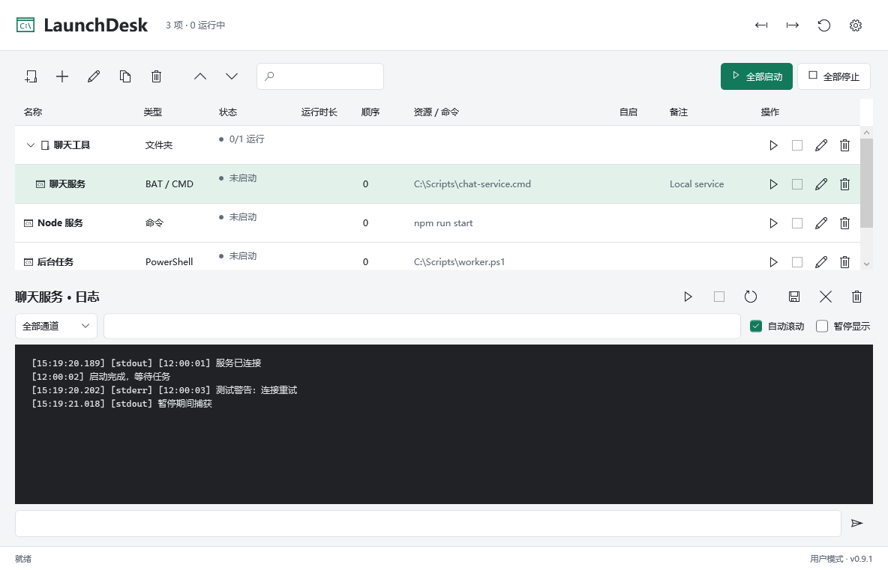

<div align="center">

# LaunchDesk

**开源 Windows 本地程序与服务启动管理器**

集中启动脚本、命令与程序，告别分散的命令行窗口。

[简体中文](README.md) | [English](README.en.md)

[](https://github.com/hailaij/LaunchDesk/releases/latest)
[](https://github.com/hailaij/LaunchDesk/releases)
[](https://github.com/hailaij/LaunchDesk/actions/workflows/windows.yml)
[](https://github.com/hailaij/LaunchDesk/releases/latest)
[](LICENSE)

[下载安装](https://github.com/hailaij/LaunchDesk/releases/latest) · [使用指南](docs/user-guide.md) · [反馈问题](https://github.com/hailaij/LaunchDesk/issues) · [更新日志](CHANGELOG.md)

</div>



> 当前正式版本：**v0.9.1**。安装包**未签名，需手动下载安装**；正式发布不等于发行者签名认证。截图由隔离测试数据生成，首次安装不会带示例启动项或日志。[更多界面截图](docs/screenshots.md)

## 目录

- [项目简介](#项目简介)
- [功能特性](#功能特性)
- [支持的启动项](#支持的启动项)
- [快速开始](#快速开始)
- [文档](#文档)
- [技术栈与结构](#技术栈与结构)
- [贡献](#贡献)
- [常见问题](#常见问题)
- [更新日志](#更新日志)
- [开源与隐私](#开源与隐私)

## 项目简介

LaunchDesk 面向需要反复启动多个本地程序或后台服务的 Windows 用户，例如本地机器人使用者、开发者和轻量运维用户。

将 BAT、npm 命令及可执行程序保存为启动项，按文件夹分组，设置工作目录、依赖与启动顺序，集中查看运行状态和日志。它是本地进程管理工具，不是远程管理平台、完整交互终端或容器编排系统。

## 功能特性

### 集中管理启动项

单项、文件夹与全部启动/停止；支持拖拽排序、原位修改名称和备注、登录自启、托盘及单实例。文件夹只是应用内分组，不移动实际脚本。

### 依赖启动与就绪检测

启动前检查路径、解释器和简单 npm 配置；支持依赖顺序、启动延迟，以及 TCP、HTTP 或日志关键词就绪检测。运行健康监控可按项启用，自动重启默认关闭，并设置频率限制与冷却时间。

### 实时日志与进程管理

集中显示 stdout/stderr，支持搜索、通道过滤、文件夹合并日志、复制与导出。暂停显示不停止捕获；日志链接支持 Ctrl+点击。使用 Windows Job Object 管理进程树，停止时尝试优雅退出并排空输出，超时后终止受管进程。

### 数据、外观与进阶入口

支持配置导入导出、自动与手动备份、便携模式和自定义数据目录。提供中英文界面、浅色/深色/跟随系统主题，以及 CLI、崩溃恢复、按项 UAC 提权和独立后台服务托管。服务、权限与数据边界见[专项说明](docs/service-accessibility-installer.md)。

## 支持的启动项

| 类型 | 示例 | 注意事项 |
|---|---|---|
| BAT / CMD | `C:\Services\Chat\launcher.bat` | 未指定工作目录时使用脚本目录 |
| 命令 | `npm` + 参数 `run start` | 工作目录需指向包含相应脚本的项目 |
| 可执行程序 | `C:\Tools\worker.exe` | GUI 仅捕获实际写入 stdout/stderr 的输出 |
| PowerShell 脚本 | `C:\Scripts\worker.ps1` | 不绕过系统执行策略 |
| Shell 脚本 | `C:\Scripts\worker.sh` | 显式指定可直接启动的解释器，例如 Git Bash |

每项可单独设置参数、工作目录、环境变量、编码、退出输入和停止超时。脚本依赖的 Node.js、Python 等工具仍需自行安装。

## 快速开始

### 下载安装

1. 打开 [最新正式版](https://github.com/hailaij/LaunchDesk/releases/latest)。
2. 下载 `LaunchDesk-v0.9.1-win-x64-setup.exe` 安装器，或 `LaunchDesk-v0.9.1-win-x64.zip` 免安装包。
3. Windows 10/11 x64 自包含包自带 .NET；ZIP 须完整解压后运行 `LaunchDesk.exe`。
4. 点击添加图标，填写资源/命令、参数和工作目录，再启动该项。

安装器默认安装至 `%LOCALAPPDATA%\Programs\LaunchDesk`，仅当前用户。升级前备份配置，并从托盘菜单彻底退出旧实例；这会停止桌面受管启动项。便携用户保留 `portable.flag` 和 `data\`。

> 更新检查只获取正式版本信息。发现新版后，用户点击“打开下载页”在默认浏览器手动下载和安装；程序不下载、验签或执行安装包，也不自动打开浏览器。SHA-256 只能检查完整性，不能证明发行者身份。

### 从源码构建

需要 Windows x64 和 `global.json` 指定的 **.NET SDK 10.0.401**；生成安装器还需 Inno Setup 6。

```powershell
git clone https://github.com/hailaij/LaunchDesk.git
cd LaunchDesk
dotnet restore LaunchDesk.slnx --locked-mode
dotnet build LaunchDesk.slnx -c Release
dotnet run --project src/LaunchDesk.App -c Release
```

打包、测试和安装器编译步骤见[详细使用与开发参考](docs/advanced-guide.md)。打包必须使用新的输出目录，非空发布目录会被拒绝。

## 文档

| 文档 | 内容 |
|---|---|
| [使用指南](docs/user-guide.md) | 启动项、分组、日志、健康监控与日常操作 |
| [详细使用与开发参考](docs/advanced-guide.md) | 编码、数据保存、进程生命周期、构建和测试命令 |
| [界面截图](docs/screenshots.md) | 当前版本中英文、深色主题及空白首次运行 |
| [服务、无障碍与安装器](docs/service-accessibility-installer.md) | CLI、提权、服务托管及验收边界 |
| [项目结构](docs/project-structure.md) | 源码、测试、脚本和产物目录 |
| [更新边界](docs/update-security.md) | 版本检查、浏览器下载与独立签名发布门禁 |
| [版本验证](docs/release-v0.9.1.md) | 发布来源、验证范围及已知限制 |
| [测试隔离与规模验证](docs/scale-and-test-gates.md) | 测试超时、资源键、1000 项及 200 MiB 门禁 |
| [安全政策](SECURITY.md) / [隐私政策](PRIVACY.md) | 漏洞报告、联网与本地数据处理 |

## 技术栈与结构

| 组件 | 技术 / 职责 |
|---|---|
| 桌面界面 | C#、.NET 10、WPF |
| 核心管理 | Windows Job Object、双通道日志、JSON 配置与备份 |
| 后台托管 | 独立 Host、Windows 服务与提权助手 |
| 安装与验证 | Inno Setup 6、PowerShell、GitHub Actions |

`src/LaunchDesk.App` 是桌面界面，`LaunchDesk.Core` 是核心逻辑，`LaunchDesk.Cli` 是命令行入口，`LaunchDesk.Host` 是后台宿主；`tests/`、`scripts/`、`tools/` 和 `docs/` 分别保存回归、构建脚本、发行检查及文档。生成文件统一放在 `artifacts/`。

`main` 为当前开发与发布说明；`dev` 保留截至 v0.8.1 的历史。旧标签与 Release 保持不变。

## 贡献

欢迎提交 [Issue](https://github.com/hailaij/LaunchDesk/issues) 或 Pull Request。反馈时提供版本、Windows 版本、复现步骤与脱敏后的错误片段，不公开令牌、环境变量、私人配置或完整日志。

开发修改前请阅读[开发参考](docs/advanced-guide.md)，运行构建和相关隔离回归。当前核心清单为 110 组；缺少隔离签名样本时 3 组明确跳过，严格 CI 不接受跳过。不要在开发电脑安装测试根证书。

## 常见问题

**npm 提示 Missing script: start？**

确认工作目录是正确项目，且其 `package.json` 定义了 `scripts.start`。这不是把 npm 改成 EXE 就能解决的问题。

**关窗口后程序还在运行？**

关闭窗口会收起到托盘；使用托盘“退出”彻底结束程序及其桌面受管启动项。

**配置和日志在哪里？**

默认在 `%LOCALAPPDATA%\LaunchDesk`；便携模式使用程序旁的 `data\`。设置显示实际目录并提供数据/备份入口。卸载保留用户数据。

**能管理 WSL、Docker 或远程服务器吗？**

不提供它们内部的生命周期或远程管理。外部宿主、已存在的 GUI 单实例进程可能不属于受管 Job；仅写入文件的日志也不会自动被当作 stdout/stderr 捕获。

**正式版是否已经签名并完成所有实机验收？**

没有。安装包仍未签名；Win10 实机、真实服务、UAC/SCM、读屏和 1 小时耐久等验收待完成。历史 npm/PowerShell 偶发退出超时的根因尚未确认，后续通过不等于根因修复。详见 [Release 验证说明](https://github.com/hailaij/LaunchDesk/releases/tag/v0.9.1)。

## 更新日志

完整版本记录已移至 [CHANGELOG.md](CHANGELOG.md)；英文记录见 [CHANGELOG.en.md](CHANGELOG.en.md)。发布文件及验证记录见 [Releases](https://github.com/hailaij/LaunchDesk/releases)。

## 开源与隐私

基于 [MIT License](LICENSE) 开源。第三方组件与运行时条款见 [THIRD-PARTY-NOTICES.md](THIRD-PARTY-NOTICES.md)，数据及联网说明见 [PRIVACY.md](PRIVACY.md)。安全问题请按 [SECURITY.md](SECURITY.md) 报告。

如果 LaunchDesk 对你有帮助，欢迎分享真实使用场景、报告问题或贡献改进。
