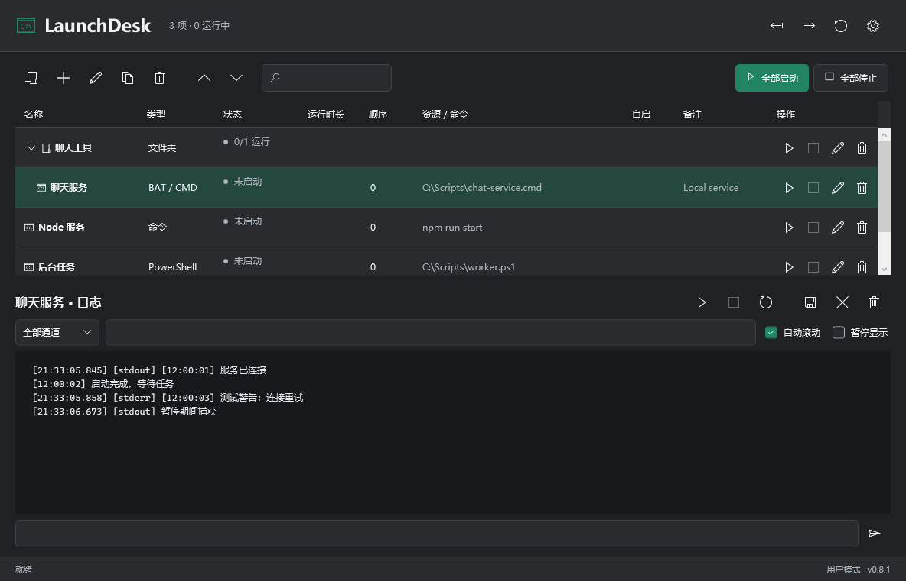
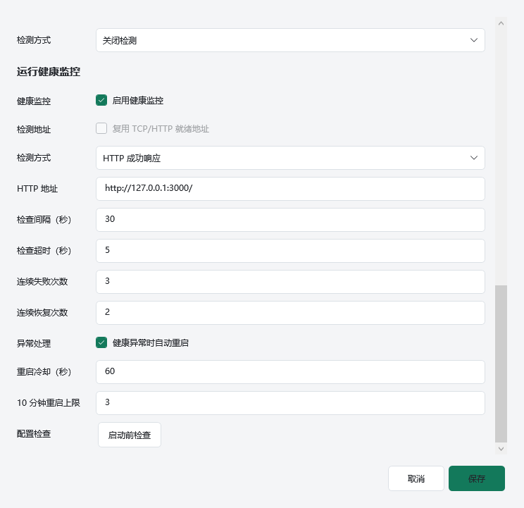
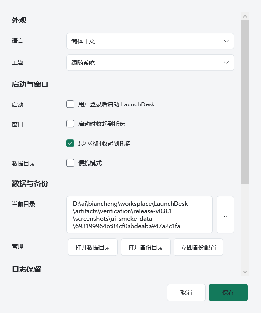
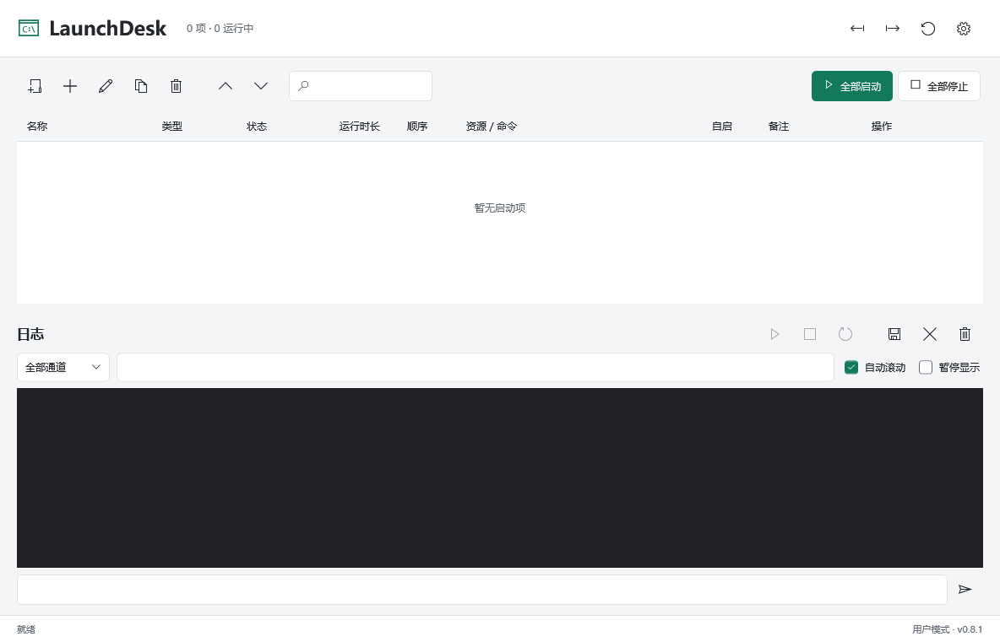

# Screenshots / 界面截图

v0.8.1, generated from the current WPF application on 2026-10-12.
截图由当前程序的隔离界面测试生成，示例启动项未执行，也不会随首次安装创建。
These are fixture previews, not preinstalled services or user configuration.
Version and image SHA-256 inventory: [manifest](images/manifest.json).
`tests/Verify-Documentation.ps1` checks all repository Markdown image references,
their hashes and the current version in CI; visual inspection is still required.

## 简体中文

## English

## Dark Theme / 深色主题

## Health Settings / 健康监控设置

## Settings / 设置

## First Launch / 首次运行

Real UAC/SCM, screen readers and physical Windows 10 acceptance remain pending.
真实 UAC/SCM、读屏软件和 Windows 10 实机验收仍待完成。
